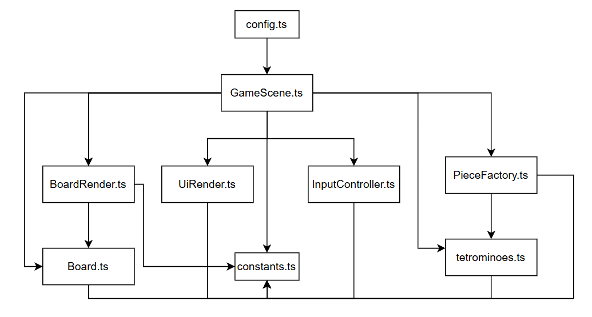

# Тетрис

Классический **Тетрис**, написанный на **TypeScript + Phaser + Vite** в рамках курса
«Проектирование и разработка игровых приложений». 

## Что это за игра?

Сверху на поле 10×20 клеток падают фигуры-тетромино (I, O, T, S, Z, J, L — каждая своего цвета).
Игрок может двигать их по горизонтали и поворачивать, чтобы составлять сплошные горизонтальные ряды.

- Заполненный ряд полностью исчезает, а все ряды над ним сдвигаются вниз.
- За удаление линий начисляются очки: 100 за одну, 300 за две, 500 за три, 800 за четыре.
- Когда новая фигура не может появиться на поле — **игра окончена**.

## Как управлять?

| Клавиша      | Действие                                   |
| ------------ | ------------------------------------------ |
| `←` / `→`    | Двигать фигуру влево / вправо              |
| `↑`          | Повернуть фигуру на 90° по часовой стрелке |
| `↓`          | Ускорить падение (soft drop)               |
| `Пробел`     | Мгновенно сбросить фигуру вниз (hard drop) |
| `R` / `Enter`| Начать игру заново (в любой момент)        |
| `P` / `Esc`  | Пауза                                      |

## Что должен делать игрок?

Цель — набрать как можно больше очков и продержаться как можно дольше:

1. Укладывать падающие фигуры так, чтобы не оставалось дыр.
2. Собирать сплошные горизонтальные ряды — они исчезают и приносят очки.
3. Стараться закрывать **несколько рядов за один ход** — очки за них растут нелинейно (до 800 за четыре).
4. Не давать стопке фигур дойти до верха поля — иначе игра заканчивается.

## Что пока не реализовано?

1. Мобильная адаптация

## Архитектурная схема



## Запуск проекта

- **Node.js 22 LTS** (или Node.js >= 20.19)

```bash
npm install
npm run dev
```

Vite напечатает адрес локального сервера, обычно `http://localhost:5173/` — открой его в браузере.

Проверка production-сборки перед публикацией:

```bash
npm run build
npm run preview
```

## Структура проекта

```text
.
├── .github/workflows/deploy.yml   # автоматическая публикация
├── src/
│   ├── game/
│   │   ├── config.ts              # конфигурация Phaser
│   │   └── GameScene.ts           # основная стартовая сцена
│   ├── main.ts                    # точка входа
│   └── style.css                  # страница вокруг canvas
├── AGENTS.md                      # правила для AI-кодинга
├── CHANGELOG.md                   # короткий журнал своей работы
├── TROUBLESHOOTING.md             # если что-то не запускается
├── index.html
├── package.json
├── tsconfig.json
└── vite.config.ts
```

## Публикация

В репозитории есть workflow `.github/workflows/deploy.yml`: после push в ветку `main`
проект автоматически собирается и публикуется на GitHub Pages.
Для первого включения: **Settings → Pages → Source: GitHub Actions**.
